# Mnemos architecture

The normal local runtime is one authenticated loopback service. CLI, MCP, UI, and host adapters are clients. They share one SQLite writer, one owning asyncio loop, providers, durable jobs, and a maintenance scheduler. The embedded MnemosEngine API remains available for experiments; it does not provide the service's complete lifecycle contract on its own.

## Capture and maintenance

```mermaid
flowchart LR
    H[Claude Code / Codex / Hermes] --> C[Client]
    C -->|authenticated local HTTP| S[Local memory service]
    C -->|service unavailable| O[Sanitized private outbox]
    O -->|retry with stable identity| S
    S --> V[Scope and write policy]
    V --> T[Atomic event and job transaction]
    T --> DB[(SQLite)]
    DB --> M[Leased maintenance job]
    M --> P[Configured local providers]
    P --> F[Typed proposals and evidence validation]
    F --> A[Atomic facts / evidence / revisions / completion]
    A --> DB
```

Capture returns after the source event and job commit. SQLite uses WAL and FULL synchronization. An acknowledged event can still have pending fact processing. Provider calls happen outside write transactions; leases and bounded retries recover interrupted work. Processed raw events expire after 30 days by default. Pending and failed source events remain available for recovery.

Explicit remember bypasses automatic surprisal selection while retaining safety and scope checks. Correct requires the current version and preserves the fact's identity. Forget removes live content, records content-free suppression identities, and prevents old events or extraction already in flight from recreating it. Fact commits include evidence and revision history atomically.

## Scope and retrieval

A persisted registry maps canonical Git common directories or non-Git roots to stable project UUIDs. Every request carries a registered user profile, project, host, and session. Workspace membership is explicit. Global facts remain private to the user profile. Scope predicates precede vector and lexical selection, graph traversal, inspection, and mutation.

Baseline retrieval is the default: scoped exact vector search plus bounded lexical candidates, a semantic floor, deduplication, and a context budget. SQLiteStore uses sqlite-vec where available; its fallback loads only authorized rows. FTS5 contributes candidates, not an invented score added to cosine similarity.

The experimental biomimetic profile can add measured state agreement and bounded graph energy. State routing uses `0.7 * semantic_similarity + 0.3 * state_match` when state exists; unavailable state is reported. Spreading uses `E_next = E_current * (1 - decay_rate) * edge_weight`, retains the strongest bounded path, and cannot amplify cycles. Query-local energy is not persisted.

Graph startup hydration is bounded. Query-time traversal can load authorized persisted neighbors beyond the startup page. Derived edges carry an algorithm/settings/embedding contract; incompatible edges rebuild in resumable batches. Corrections refresh affected edges. Recall records score traces and access metadata without silently rewriting fact content.

## Module boundaries

| Module | Managed runtime responsibility |
| --- | --- |
| SurprisalGate | Select automatic episodes using prediction/input distance; explicit remember bypasses it |
| AffectiveRouter | Measure available state and expose its actual ranking contribution |
| SleepDaemon | Produce schema-validated, source-backed proposals from captured evidence |
| SpreadingActivation | Traverse bounded, scoped, weighted neighborhoods |
| MutableRAG | Review source-backed corrections with expected-version checks |

Independent switches support ablations. Disabling an experimental module does not disable explicit correct or forget. Mechanism tests do not establish a quality advantage over baseline; that requires held-out evaluation.

## Operations

Descriptors, registry, database, outbox, configuration, checkpoints, and backups use owner-private permissions. The service binds to loopback and authenticates requests with a private bearer descriptor. The UI adds CSRF and Host checks and escapes stored content. The safety firewall screens source content and metadata before persistence.

Backup uses SQLite's snapshot API and manifest hashes. Restore writes a new destination and merges current suppression records without activating the copy. Offline reindex holds the runtime ownership lock, preserves active vectors while staging, validates content versions and provider identity, and backs up before activation. `mnemos service-stop` provides authenticated shutdown.

SQLiteStore is the supported persistence path; InMemoryStore is for isolated development. See [functional local memory](docs/functional-local-memory.md), [host evidence](docs/client-compatibility-matrix.md), and [paper errata](docs/paper-errata.md). Historical paper examples are not native-host, real-model quality, or pilot acceptance.